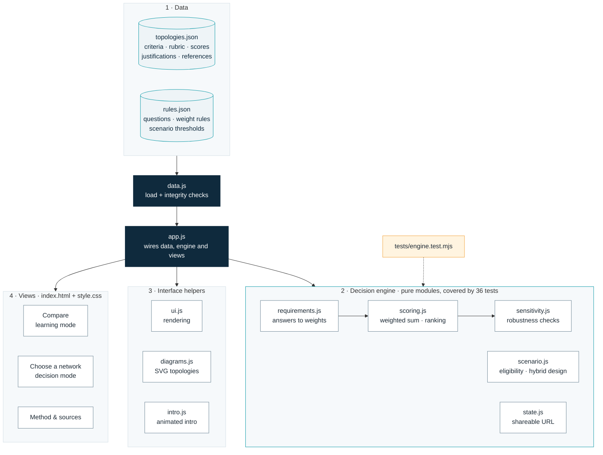
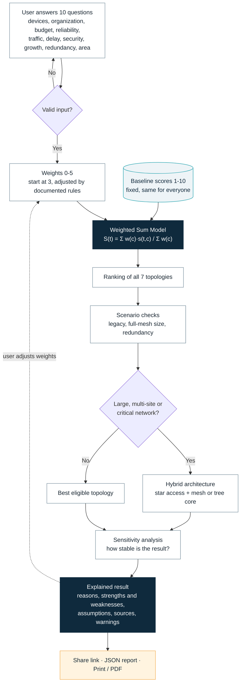

# NetTopoRank: Network Topology Comparison and Selection

An explainable learning and decision-support tool for network topologies. It compares seven classic topologies across eight criteria, and turns plain-language network requirements into an explained, sensitivity-tested recommendation.

**Live site:** https://dr-ahmed-abdelsalam.github.io/network-topology-selector/

> **Educational guidance, not an engineering-validated design.** Results support learning and early planning. Real designs need site surveys, traffic measurements and vendor specifications.

## Three modes

| Mode | For | What it does |
|---|---|---|
| **Compare** (learning) | Students | Concept primer (physical vs logical topology, switching vs routing, media access, mesh vs full mesh), a card per topology with category and status badges, the baseline scoring matrix, per-score justification with sources, and free weight exploration. |
| **Choose a network** (decision) | Businesses and planners | A 10-question form in plain language. Answers become criterion weights; the tool ranks the options, applies scenario checks, proposes a hybrid architecture where appropriate, explains the result, tests its robustness and lists the sources. |
| **Method & sources** | Everyone | Formula, scoring rubric, every answer-to-weight rule, scenario checks, limitations and the audited reference list. |

A short animated intro ("How it works") explains the three layers before first use: fixed scores, weights from your needs, and the resulting ranking. It is skippable, shown once, and respects reduced-motion settings.

## How the numbers work

```
S(t) = Σ w(c) · s(t,c) / Σ w(c)
```

| Layer | Changes with user input? | Source |
|---|---|---|
| **Baseline scores** `s(t,c)`, 1–10, 10 = most favourable | **No.** Same for everyone | `data/topologies.json` |
| **Weights** `w(c)`, 0–5 | **Yes.** Start at 3; each answer adds a documented amount; the user can then adjust them | `data/rules.json` |
| **Scenario checks** | **Yes**, but they never change scores. They mark options as not recommended and add hybrid designs | `data/rules.json` → `scenario` |

### Baseline matrix

| Topology | Arch. | Delay | Complexity | Security | Congestion | Routing | Reliability | Cost | Total /80 |
|---|---|---|---|---|---|---|---|---|---|
| Bus | 5 | 5 | 9 | 3 | 3 | 4 | 3 | 9 | 41 |
| Star | 8 | 8 | 8 | 7 | 7 | 7 | 6 | 7 | 58 |
| Ring | 5 | 5 | 6 | 4 | 6 | 5 | 4 | 8 | 43 |
| Token-ring | 6 | 7 | 4 | 5 | 9 | 5 | 7 | 5 | 48 |
| Tree | 8 | 6 | 6 | 6 | 6 | 6 | 5 | 6 | 49 |
| Mesh (partial) | 7 | 8 | 4 | 8 | 8 | 9 | 8 | 4 | 56 |
| Fully connected | 5 | 10 | 2 | 9 | 10 | 10 | 10 | 1 | 57 |

Scores are the **author's analytical assessment** against a written rubric (anchors for 1, 5 and 10 on each criterion). They are not measured or published values. Each score carries a one-line reason; sources support the reasons, and reasons without a direct source are labelled "author judgement".

### Scenario checks

- **Legacy options** (Bus, Token-ring) stay in the ranking for comparison but are never recommended as modern purchases.
- **Fully connected** is not recommended above 8 nodes; the tool reports the n(n−1)/2 link count.
- **Mesh options** are not recommended when the user says redundant links and equipment are unavailable.
- **Hybrid architecture** (star access + partial-mesh or tree core, plus inter-site mesh) is proposed for 50+ devices, campus or multi-site scope, or enterprise, data-center and critical organizations.
- **Low confidence** warning when 3+ questions are answered "Not sure". **Near tie** when options are within 0.3 points.

### Sensitivity analysis

- **One weight at a time:** every weight is moved ±1; any change of winner is listed.
- **Random perturbation:** 500 seeded variations of every weight by up to ±25 % give a stability percentage.
- **Overtake conditions:** for each alternative, the smallest single-weight change that would make it win.

## Example

Input: 180 devices, medium/large company, moderate budget, outages costly, moderate traffic, delay-sensitive, elevated security, steady growth, backup links available, one building.

Output (abridged):

- **Recommended architecture:** Hierarchical hybrid, star access with a redundant partial-mesh core (Cisco hierarchical design model [9]).
- **Best single textbook topology:** Star, weighted score 7.23 / 10; Mesh (partial) 7.13 is a near tie.
- **Not recommended:** Bus and Token-ring (legacy); Fully connected (180 devices would need 16,110 links).
- **Robustness:** Star stays on top in 85 % of random weight variations; lowering Complexity from 3 to 2 would make Mesh the winner.

Every result can be shared as a link, downloaded as a JSON report, or printed / saved as PDF.

## Architecture

No backend, no build step, no dependencies: plain HTML, CSS and JavaScript modules served by GitHub Pages.

### Components



### How a recommendation is made



<details>
<summary>File structure</summary>

```
index.html               page shell: header, three views, intro dialog
assets/style.css         light/dark themes, responsive layout, print styles
assets/js/
  scoring.js             weighted sum, normalization, ranking, ties (pure)
  requirements.js        input validation, answers -> weights with trace (pure)
  scenario.js            eligibility, hybrid architecture, warnings, assumptions (pure)
  sensitivity.js         ±1 test, seeded perturbation, overtake conditions (pure)
  state.js               shareable URL state, compatible with v1 #w= links (pure)
  data.js                data loading and integrity checks
  diagrams.js            SVG topology diagrams
  ui.js                  shared rendering helpers
  intro.js               animated "how it works" intro
  app.js                 wiring between data, engine and views
data/topologies.json     criteria + rubric, topologies, scores, justifications, references, limitations (schema v2)
data/rules.json          questions, answer-to-weight rules, scenario thresholds
tests/engine.test.mjs    automated tests (Node built-in test runner)
```

</details>

## Run locally

```bash
python -m http.server 8000      # or any static server
# open http://localhost:8000
```

The page loads its data with `fetch`, so it must be served over HTTP rather than opened as a file.

## Tests

Requires Node.js 18 or later; no packages to install.

```bash
npm test          # same as: node --test tests/*.test.mjs
```

36 tests cover weighted scoring, zero-weight handling, input validation, ranking consistency, score normalization, sensitivity analysis, URL state restoration (including old v1 links), data integrity, and that the published baseline totals stay unchanged.

## Deploy on GitHub Pages

Settings → Pages → Source: **Deploy from a branch** → Branch **main**, folder **/ (root)** → Save. All paths are relative, so the site works under `/network-topology-selector/`.

## Assumptions and limitations

- Scores are ordinal judgements; the weighted sum treats their differences as equal-sized.
- The model is compensatory, so weak points are listed separately rather than hidden in the average.
- Complexity and Cost are related; weighting both highly partly counts the same concern twice.
- Security and congestion depend heavily on configuration (VLANs, access control, QoS), not on topology alone.
- Star and Tree assume switches, not hubs; mesh reliability assumes the redundant links are installed.
- Baseline scores do not depend on size; size effects are handled by explicit scenario rules.
- Token-ring is a medium-access method on a logical ring, and Fully connected is a special case of mesh. Both are kept as separate rows because they are commonly taught as distinct topologies, and the interface labels them accordingly.

## References

Status and checked fields are recorded per source in `data/topologies.json`. Page numbers are given only where verified.

1. B. A. Forouzan, *Data Communications and Networking*, 5th ed., McGraw-Hill, 2013. https://highered.mheducation.com/sites/0073376221/information_center_view0 (verified; pages not verified)
2. A. S. Tanenbaum and D. J. Wetherall, *Computer Networks*, 5th ed., Pearson, 2011 (released Sept. 2010). https://www.oreilly.com/library/view/-/9780133485936/ (verified; pages not verified)
3. Cisco Systems, "Troubleshooting Token Ring," Internetwork Troubleshooting Guide. https://cisco.com/en/US/docs/internetworking/troubleshooting/guide/tr1906.pdf (verified)
4. W. Stallings, *Data and Computer Communications*, 10th ed., Pearson, 2014. https://www.pearson.com/en-us/subject-catalog/p/data-and-computer-communications/P200000003249/9780133506488 (verified; general background)
5. IEEE TechNav, "Token Networks." https://technav.ieee.org/topic/token-networks/ (weak: topic summary)
6. CSJM University, "Network Topology" lecture notes. https://gyansanchay.csjmu.ac.in/wp-content/uploads/2023/09/Network-Topology.pdf (weak: secondary)
7. EduRev, "Requirements of Computer Networks." https://edurev.in/t/97070/Requirements-of-Computer-Networks (weak: secondary)
8. GeeksforGeeks, "What is Mesh Topology?" https://www.geeksforgeeks.org/computer-networks/advantage-and-disadvantage-of-mesh-topology/ (weak: secondary)
9. Cisco Systems, *Campus Wired LAN Technology Design Guide* (CVD), Aug. 2013, p. 5. https://www3-realm.cisco.com/en/US/docs/solutions/CVD/Aug2013/CVD-CampusWiredLANDesignGuide-AUG13.pdf (verified)
10. IEEE Std 802.5, Token Ring (inactive-withdrawn). https://standards.ieee.org/ieee/802.5/1102 (verified)

## Future directions

- Replace weak secondary sources with verified textbook page references.
- Calibrate baseline scores with expert ratings (e.g. Delphi or AHP pairwise comparison) and report inter-rater agreement.
- Size-dependent scores for cost and complexity based on link and port counts.
- Outranking methods (e.g. PROMETHEE or ELECTRE) as a non-compensatory comparison to the weighted sum.
- Arabic interface.

## Author

Dr. Ahmed Abdelsalam

## License

[MIT](LICENSE)
